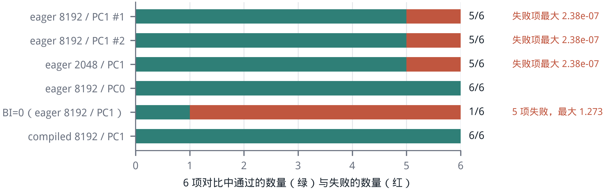

# 5. v1 在线 HTTP 结果

> **口径说明**
>
> 本章的“bs32”是**一个 HTTP 请求里放 32 条 prompt**，而不是 32 个独立并发
> 请求。v2 证明这个区别决定了结果：同样是 32 条 prompt，批量提交时第一条
> 一致、其余 31 条不一致；独立并发时也一样。因此本章只能证明“批量提交路径”
> 下的 target-only 行为，不能证明真实并发服务下的 BI。

## 5.1 API 冒烟测试

`/tokenize` 与 `/v1/completions`（`return_token_ids=true`，`logprobs=5`，
`prompt_logprobs=1`）均可正常工作；返回的 token ids 与离线 tokenizer 一致。
HTTP 层没有改写 prompt。

## 5.2 表 E：单进程内（H1–H6）

数值为最大绝对 logprob 差，✅ = token id 与 logprob 均相等。

| 配置 | bs1/bs32 | 逆序 | 短 prompt 缓存命中 | 长 prompt bs1/bs4 fresh | 长 prompt fresh/缓存命中 | decode/re-feed |
|---|---|---|---|---|---|---|
| eager_8192_pc1_run1 | 0.0 ✅ | 0.0 ✅ | 0.0 ✅ | 0.0 ✅ | 2.384e-07 ❌ | 0.0 ✅ |
| eager_8192_pc1_run2 | 0.0 ✅ | 0.0 ✅ | 0.0 ✅ | 0.0 ✅ | 2.384e-07 ❌ | 0.0 ✅ |
| eager_2048_pc1 | 0.0 ✅ | 0.0 ✅ | 0.0 ✅ | 0.0 ✅ | 2.384e-07 ❌ | 0.0 ✅ |
| eager_8192_pc0 | 0.0 ✅ | 0.0 ✅ | 0.0 ✅ | 0.0 ✅ | 0.0 ✅ | 0.0 ✅ |
| bi0_eager_8192_pc1 | 1.273e+00 ❌ | 1.307e-01 ❌ | 0.0 ✅ | 3.576e-07 ❌ | 3.576e-07 ❌ | 1.311e-01 ❌ |
| compiled_8192_pc1 | 0.0 ✅ | 0.0 ✅ | 0.0 ✅ | 0.0 ✅ | 0.0 ✅ | 0.0 ✅ |

结果：

- 对 target prompt，eager 与 compiled 的短 prompt 都是 0.0；
- eager + 长 prompt + 缓存命中是唯一的非位级情况（2.384e-07）；
- BI=0 对照出现 1.273 的差异，测试灵敏度足够；
- compiled 的长 prompt 缓存命中也 0.0。

<figure class="bi-figure" markdown="span">
  
  <figcaption>图 5　表 E 的六项比较按配置汇总。绿色为通过项数，红色为失败项数，
  右侧给出失败项的最大 \|Δlogprob\|。eager 有一项长 prompt 缓存命中的
  2.384e-07，BI=0 对照失败五项，compiled 全过。</figcaption>
</figure>

## 5.3 表 F：跨进程 / 跨配置

| 比较 | 短 token | 短 logprob | 短最大差 | 长 token | 长 logprob | 长最大差 |
|---|---|---|---|---|---|---|
| eager 同配置重启 | ✅ | ✅ | 0.0 | ✅ | ✅ | 0.0 |
| eager 8192 vs 2048 | ✅ | ✅ | 0.0 | ✅ | ✅ | 0.0 |
| eager PC1 vs PC0 | ✅ | ✅ | 0.0 | ✅ | ✅ | 0.0 |
| BI=1 vs BI=0 | ✅ | ❌ | 1.364e-01 | ✅ | ❌ | 4.768e-07 |
| compiled vs eager | ❌ | ❌ | 1.334e+00 | ✅ | ❌ | 7.153e-07 |

“compiled vs eager 短 token ❌、最大差 1.334” 是 v1 的数值；v2 用统一的
`add_special_tokens=False` 复核后，target 的首 token 差异约 `1.57e-01`。两者
方向一致：compiled 与 eager 的输出不同，且 token id 可能从第一个 token 就分叉。

## 5.4 表 G：BI=0 在线对照

| 比较 | token id | logprob | 首个差 | 最大差 |
|---|---|---|---|---|
| bs1/bs32 | ❌ | ❌ | 0 | 1.273e+00 |
| 逆序 | ✅ | ❌ | 0 | 1.307e-01 |
| 短 prompt 缓存命中 | ✅ | ✅ | — | 0.0 |
| 长 prompt bs1/bs4 fresh | ✅ | ❌ | 6 | 3.576e-07 |
| 长 prompt fresh/缓存命中 | ✅ | ❌ | 4 | 3.576e-07 |
| decode/re-feed | — | ❌ | 0 | 1.311e-01 |

## 5.5 表 H：开放结尾长 prompt 的缓存命中诊断（7584 token）

### eager

| 请求 | 首发 logprob | 前 8 个 token |
|---|---|---|
| freshA | -1.929295 | `[3908, 3743, 6941, 47290, 13, 2932, 572, 3881]` |
| hit1 | -1.964247 | `[27699, 38835, 6941, 55923, 13, 55923, 572, 3881]` |
| hit2 | -1.964247 | 同 hit1 |
| freshB | -1.929295 | 同 freshA |
| hit3 | -1.964247 | 同 hit1 |

- freshA vs freshB：位级一致；
- fresh vs hit：首个 token 就不同，最大差 `5.970e-01`；
- hit1 vs hit2：位级一致。

eager 下“缓存命中”本身是确定的，但它与 fresh prefill 走不同的数值路径；
对开放结尾 prompt，差异足以改变第一个生成 token。

### compiled

freshA、hit1、hit2、freshB、hit3 的首发 logprob 全部为 `-1.927184`，token
序列全部相同，最大差 0.0。compiled 在该诊断中 fresh 与 hit 一致。

## 5.6 表 H 的意义与局限

- 这说明“prefix cache 配置本身不破坏 BI，但命中路径可能与 fresh 不同”；
- 它只测了 target/长 prompt 本身，没有测批内其他 prompt；
- 它不能回答“32 条普通 prompt 一起提交是否一致”；那是 v2 的 B10。

## 5.7 在线测试的工程结论

1. HTTP 层没有引入额外的非确定性（同样的批量提交可重复）；
2. eager + 长 prompt + 缓存命中，在在线服务中同样改变结果；
3. `--no-enable-prefix-caching` 能消除该风险；
4. 但“短 prompt 全 0”只对 target 成立，不能作为一般性结论。
