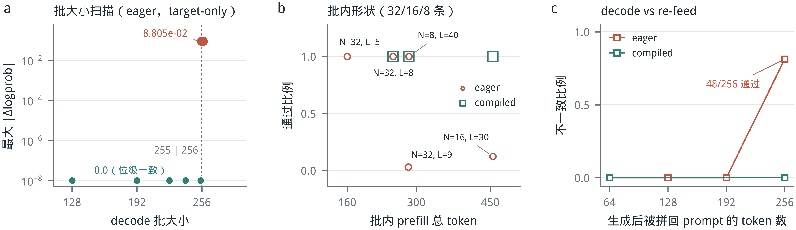

# 6. v2 边界实验结果

本章的表由 `analyze_extra.py` 与
`analyze_online_extra.py` 从原始 JSON 自动生成；表号沿用 I–Q（Q 为离线 32-prompt 复核）。

<figure class="bi-figure" markdown="span">
  
  <figcaption>图 6　本章三块边界的全貌。a：eager 的 decode 批大小扫描，255 与
  256 之间有干净的分界；b：批内 prefill 形状，横轴是总 token 数，纵轴是 32 条
  请求中通过的比例（compiled 全过）；c：把生成的 token 拼回 prompt 后的不一致
  比例，eager 与 compiled 都随长度上升。分别对应表 I、表 N、表 O。</figcaption>
</figure>

## 6.1 批大小扫描（target-only，eager，PC=0）

配置：eager，FLASH_ATTN，PC=0，chunk=8192，greedy，32 token。比较对象是
5-token target 的 `single` vs `batch`。

### 表 I

| 批大小 | bs1 vs batch | 逆序 | 首次不一致 | 最大 \|Δlogprob\| | token id | decode vs re-feed |
|---|---|---|---|---|---|---|
| bs128 | 0.0 ✅ | 0.0 ✅ | — | 0.000e+00 | ✅ | 0.0 ✅ |
| bs192 | 0.0 ✅ | 0.0 ✅ | — | 0.000e+00 | ✅ | 0.0 ✅ |
| bs224 | 0.0 ✅ | 0.0 ✅ | — | 0.000e+00 | ✅ | 0.0 ✅ |
| bs240 | 0.0 ✅ | 0.0 ✅ | — | 0.000e+00 | ✅ | 0.0 ✅ |
| bs255 | 0.0 ✅ | 0.0 ✅ | — | 0.000e+00 | ✅ | 0.0 ✅ |
| bs256 | 8.805e-02 ❌ | 8.805e-02 ❌ | 5 | 8.805e-02 | ✅ | 0.0 ✅ |
| bs257 | 8.805e-02 ❌ | 8.805e-02 ❌ | 5 | 8.805e-02 | ✅ | 0.0 ✅ |

结果：

- 边界非常干净：**255 一致，256 开始不一致，257 也不一致**；
- 不一致从第 5 个生成 token 开始，token id 在 32 步内仍然相同；
- 这是“logprob 层面的 BI 失败”，不是“文本变了”；
- PC=0，因此与 prefix cache 无关。

## 6.2 bs=256 的条件隔离

### 表 J

| 配置 | bs1 vs batch | 逆序 | sampled single vs batch | 首次不一致 | 最大 \|Δlogprob\| | decode vs re-feed |
|---|---|---|---|---|---|---|
| eager PC1 bs256 | 8.805e-02 ❌ | 8.805e-02 ❌ | — | 5 | 8.805e-02 | 0.0 ✅ |
| eager PC0 bs256 | 8.805e-02 ❌ | 8.805e-02 ❌ | — | 5 | 8.805e-02 | 0.0 ✅ |
| eager PC0 bs256 + ignore_eos | 8.805e-02 ❌ | 8.805e-02 ❌ | — | 5 | 8.805e-02 | 0.0 ✅ |
| eager PC0 bs256 全 target | 8.805e-02 ❌ | 8.805e-02 ❌ | — | 5 | 8.805e-02 | 0.0 ✅ |
| eager PC0 bs256 max_num_seqs=512 | 8.805e-02 ❌ | 8.805e-02 ❌ | — | 5 | 8.805e-02 | 0.0 ✅ |
| eager PC0 bs256 max_num_seqs=128 | 0.0 ✅ | 0.0 ✅ | — | — | 0.000e+00 | 0.0 ✅ |
| compiled PC0 bs256 | 0.0 ✅ | 0.0 ✅ | — | — | 0.000e+00 | 0.0 ✅ |
| eager PC0 bs256 temp=0.7 | 8.805e-02 ❌ | 8.805e-02 ❌ | 9.294e-02 ❌ | 5 | 8.805e-02 | 0.0 ✅ |
| eager PC0 bs256 temp=0.7 max_num_seqs=128 | 0.0 ✅ | 0.0 ✅ | 0.0 ✅ | — | 0.000e+00 | 0.0 ✅ |
| eager PC0 bs256 生成 256 token | 1.377e-01 ❌ | 1.377e-01 ❌ | — | 5 | 1.377e-01 | 1.377e-01 ❌ |
| eager PC0 bs256 生成 256 token max_num_seqs=128 | 0.0 ✅ | 0.0 ✅ | — | — | 0.000e+00 | 1.377e-01 ❌ |
| compiled PC0 bs256 生成 256 token | 0.0 ✅ | 0.0 ✅ | — | — | 0.000e+00 | 0.0 ✅ |

结果：

1. **不是 prefix cache**：PC0/PC1 数值相同；
2. **不是 EOS 导致批收缩**：ignore_eos 相同；
3. **不是批内容差异**：全 target 相同；
4. **不是默认 max_num_seqs 上限**：设 512 仍失败；
5. **把 max_num_seqs 限到 128 可以恢复**：256 个请求分两波跑，每波 ≤128；
6. **compiled 在 bs256 直接通过**；
7. **temperature=0.7、seed=42 下也失败**，且采样 token 在 32 步内仍相同；
8. 生成 256 token 时，eager 的 decode vs re-feed 也失败（1.377e-01），即使
   bs 限到 128 也不能修复 re-feed（它是 prefill 长度问题，见 6.4）。

## 6.3 正交配置：TP、attention、chunk、采样、长上下文

### 表 K

| 配置 | bs1 vs batch | 逆序 | 长 prompt | decode vs re-feed |
|---|---|---|---|---|
| TP=4 基线 bs128 | 0.0 ✅ | 0.0 ✅ | 2.384e-07 ❌ | 0.0 ✅ |
| TP=2 bs32 | 0.0 ✅ | 0.0 ✅ | 4.768e-07 ❌ | 0.0 ✅ |
| TP=2 重复进程 | 0.0 ✅ | 0.0 ✅ | 4.768e-07 ❌ | 0.0 ✅ |
| TRITON_ATTN bs32 | 0.0 ✅ | 0.0 ✅ | 4.768e-07 ❌ | 0.0 ✅ |
| chunk=2048 bs128 | 0.0 ✅ | 0.0 ✅ | 2.384e-07 ❌ | 0.0 ✅ |
| temperature=0.7 bs32 | 0.0 ✅ | 0.0 ✅ | 2.384e-07 ❌ | 0.0 ✅ |
| 生成 256 token bs32 | 0.0 ✅ | 0.0 ✅ | 4.768e-07 ❌ | 1.377e-01 ❌ |
| 长 prompt 8180 PC0 | 0.0 ✅ | 0.0 ✅ | 0.0 ✅ | 0.0 ✅ |
| 长 prompt 8180 PC1 | 0.0 ✅ | 0.0 ✅ | 0.0 ✅ | 0.0 ✅ |

补充：

- 这些“bs1 vs batch”仍然是 **target-only**；它们只说明 target 在各自配置内
  部一致，不代表其他 prompt；
- TP=2 的进程内重复和跨进程重复都稳定（表 L）；
- chunk=2048 对短 target 没有影响；
- 7600-token 长 prompt 在 eager 下有 `2.384e-07`（TP4）或 `4.768e-07`（TP2、
  TRITON）的 fresh vs cache-hit 差异；
- **8180-token 近最大上下文在 PC0/PC1 都恰好 0.0**。这和 7600 的结果不矛盾：
  是否出现差异取决于 chunk/tail 的具体几何，不能简单说“长 prompt 必坏”。

### 表 L：跨配置（同一个短 target 的 `single`）

| 比较 | token id | logprob | 首次不一致 | 最大 \|Δlogprob\| |
|---|---|---|---|---|
| TP=2 vs TP=4 | ✅ | ❌ | 0 | 1.342e-01 |
| TP=2 进程 1 vs 进程 2 | ✅ | ✅ | — | 0.000e+00 |
| TRITON_ATTN vs FLASH_ATTN | ❌ | ❌ | 0 | 1.334e+00 |
| compiled vs eager（均 PC=0） | ❌ | ❌ | 0 | 1.334e+00 |

结果：

- TP size 是 **BI 的边界**：TP=2 与 TP=4 的 logprob 从第 0 位就不同，尽管各自
  进程内稳定；
- attention backend 也是边界：TRITON_ATTN 与 FLASH_ATTN 的 token id 从第 0 位
  就分叉；
- compiled 与 eager 也是边界：同一 prompt，首 token 就不同。

## 6.4 decode vs re-feed 的 256-token 边界

### 表 O

| 生成 token 数 | 拼回后总长度 | 通过/比较数 | 首个不一致 | 最大 \|Δlogprob\| |
|---|---|---|---|---|---|
| 64 | 69 | 64/64 | — | — |
| 128 | 133 | 128/128 | — | — |
| 192 | 197 | 192/192 | — | — |
| 256 | 261 | 48/256 | 5 | 1.377e-01 |
| 256（compiled） | 261 | 256/256 | — | — |

说明：

- 生成 192 token（拼回长度 197）时，逐 token 解码与一次 prefill 的 prompt
  logprob 完全一致；
- 生成 256 token（拼回长度 261）时，208/256 个位置不一致，首个在第 5 个；
- 边界与“总长度是否超过 256”吻合；
- compiled 在 261 长度下 256/256 一致。

这不是 prefix cache 问题（PC=0），也不是采样问题（greedy）；它是 **prefill
路径与 decode 路径在长度跨过 256 后选择了不同数值路径** 的直接证据。

## 6.5 32 条 prompt：单独 vs 批内（主要更正）

### 表 P（模型 / 后端对照）

| 配置 | 通过/总数 | 批重复一致 | 说明 |
|---|---|---|---|
| Qwen3-30B-A3B, eager, FLASH, chunked | 1/32 | 是 | 基线 |
| Qwen3-30B-A3B, eager, TRITON_ATTN | 1/32 | 是 | 换 attention 后端 |
| Qwen3-30B-A3B, eager, FLASH, 无 chunked | 1/32 | 否（1） | 关 chunked prefill |
| Qwen3-30B-A3B, eager, moe=triton（显式） | 2/32 | 是 | 默认 MoE 后端 |
| Qwen3-0.6B 稠密模型, eager, FLASH | 2/32 | 否（1） | 排除 MoE 因素 |
| Qwen3-30B-A3B, compiled, FLASH | 32/32 | 是 | torch.compile + CUDA graphs |

结果：

- **基线 eager 只有 1/32 通过**；通过的那条是 5-token target（prompt0）；
- 换 TRITON_ATTN 仍 1/32；
- 关 chunked prefill 仍 1/32，且批重复出现 1 条不一致；
- 显式 `moe_backend=triton` 仍 2/32；
- 换成 **稠密 Qwen3-0.6B** 仍 2/32，说明不是 MoE 特有；
- 只有 **compiled 32/32 通过**，且重复批一致。

这条结果推翻了“短 prompt 全 0”的外推：v1 的 target 恰好是那条不敏感的 prompt。

离线 `LLM.generate` 复核（`bi_batchall_offline.py`，eager/PC0/32 条，表 Q）
得到同样的结论：

| 运行 | 通过/总数 | 不一致的 prompt | 重复批不一致 |
|---|---|---|---|
| `LLM.generate`：32 条单独 vs 批内 | 1/32 | prompt1 … prompt31 | 1 |

同一批请求重复运行时 eager 也会失败：32 条中有 1 条不一致。

## 6.6 批内 prompt 长度扫描：256-token 边界

### 表 N（eager）

| N | 每个 filler 长度 | 总 prefill token | 通过/总数 | 最大 \|Δlogprob\| | 重复批一致 |
|---|---|---|---|---|---|
| 16 | 30 | 455 | 2/16 | 9.614e-02 | 是 |
| 32 | 5 | 160 | 32/32 | 0.000e+00 | 是 |
| 32 | 8 | 253 | 32/32 | 0.000e+00 | 是 |
| 32 | 9 | 284 | 1/32 | 1.590e+00 | 否（1） |
| 8 | 40 | 285 | 8/8 | 0.000e+00 | 是 |

### compiled 对照

| N | 每个 filler 长度 | 总 prefill token | 通过/总数 | 最大 \|Δlogprob\| |
|---|---|---|---|---|---|
| 16 | 30 | 455 | 16/16 | 0.000e+00 |
| 32 | 8 | 253 | 32/32 | 0.000e+00 |
| 32 | 9 | 284 | 32/32 | 0.000e+00 |
| 8 | 40 | 285 | 8/8 | 0.000e+00 |

结果：

- N=32、总 160 或 253：全过；总 284：1/32；
- N=16、总 455：2/16；
- N=8、总 285：8/8（**反例**：总 token 超过 256 但仍全过）；
- compiled 全部通过。

因此“总 prefill token > 256”不是唯一条件；还需要批内序列数足够多
（本次 N≥16 时失败，N=8 时不失败）。经验边界可以写成：

> 当一次 prefill 同时包含较多序列（约 ≥16）且总 token 达到约 256 以上时，
> eager 的数值路径会改变；具体落在哪组形状上，本文没有给出闭式。

第 9 章测过单个算子的 tile 配置：BI 下线性层与 MoE 都是常量，注意力在
255 与 256 上逐位相同，所以这条边界不是某个算子切换 tile 的直接结果。

这也对应 6.5 中 32 条短 prompt 的失败：N=32，标准 filler 每条 14–16 token，总 prefill 约 483 token。

## 6.7 真实并发与突发请求

### 表 M

| 场景 | 模式 | N | 通过/总数 | 最大 \|Δlogprob\| |
|---|---|---|---|---|
| 独立并发（短 prompt） | eager PC0 | 32 | 1/32 | 2.723e+00 |
| 独立并发（短 prompt） | eager PC1 | 32 | 1/32 | 2.723e+00 |
| 独立并发（短 prompt） | compiled PC1 | 32 | 32/32 | 0.000e+00 |
| 突发（有背景解码） | eager PC0 | 32 | 1/32 | 2.723e+00 |
| 突发（无背景解码） | eager PC0 | 32 | 1/32 | 2.723e+00 |
| 突发（有背景解码） | compiled PC1 | 32 | 32/32 | 0.000e+00 |
| 突发（无背景解码） | compiled PC1 | 32 | 32/32 | 0.000e+00 |
| 单次批量请求 | eager PC0 | 32 | 1/32 | 2.723e+00 |
| 单次批量请求 | compiled PC1 | 32 | 32/32 | 0.000e+00 |
| 单个请求插入解码中的批次 | eager PC0 | 1 | 4/4 | 0.000e+00 |
| 单个请求插入解码中的批次 | eager 无 chunked | 1 | 4/4 | 0.000e+00 |
| 单个请求插入解码中的批次 | compiled PC0 | 1 | 4/4 | 0.000e+00 |

说明：

- eager 的失败**不是并发专有**：单次批量请求（32 条一起提交）同样 1/32；
- “第一条通过、其余 31 条失败”说明失败跟随批内位置/形状，而不是 HTTP 连接；
- 单个请求插入正在解码的批次（4 个延迟）全部通过，说明“少量混合”本身没问题；
- compiled 在所有到达方式下 32/32 通过。

因此，v1 的“在线 BI 成立”其实是“**一个请求里批量提交，且只检查 target**”
的产物，不是真实服务的 BI 保证。

## 6.8 近最大上下文 8180

配置：4 条请求（long + 3 filler），长 prompt 8180 token，max_tokens=8，
PC0/PC1 各一次。

- PC0：`single vs batch`、逆序、`long_batch vs long_single`、decode/refeed
  全部 0.0；
- PC1：同样全部 0.0，包括 `long_batch` 先跑、`long_single` 命中缓存的比较。

这与 7600-token 的 `2.384e-07` 不矛盾：是否分叉取决于 chunk/tail 的边界
是否恰好对齐。结论应表述为“长 prompt 的缓存命中可能分叉，但不是必然”；
严格性要求下仍建议 PC off 或 compiled。

## 6.9 MoE / attention 后端的可用性

- 默认非量化 MoE 后端：**TRITON**；
- `flashinfer_cutlass`：启动失败，
  `Unquantized MoE backend FlashInfer CUTLASS does not support the deployment
  configuration since kernel does not support current device cuda`（SM86 不支持）；
- `flashinfer_trtllm`：启动失败（同类设备/内核不支持）；
- 显式 `triton`：可用，但 32-prompt 仍 2/32；
- `TRITON_ATTN`：可用，但 32-prompt 仍 1/32。

在本机 SM86 上，更换 MoE 后端不能修复 eager 的 BI。

## 6.10 本章小结

- eager 的 BI 有清晰的形状边界：小批/短总长通过，大批/长总长失败；
- 256 是一个反复出现的数字（decode 批 256、prefill 总长跨 256、re-feed 总长
  261），但 N=8/285 的反例说明它不是简单的“总 token ≤256”；
- 失败与 prefix cache、EOS、采样、MoE、attention 后端、chunked prefill 都
  不是一对一关系；
- compiled 在全部这些维度上通过；
- compiled 与 eager 的输出不同，不能混用。
