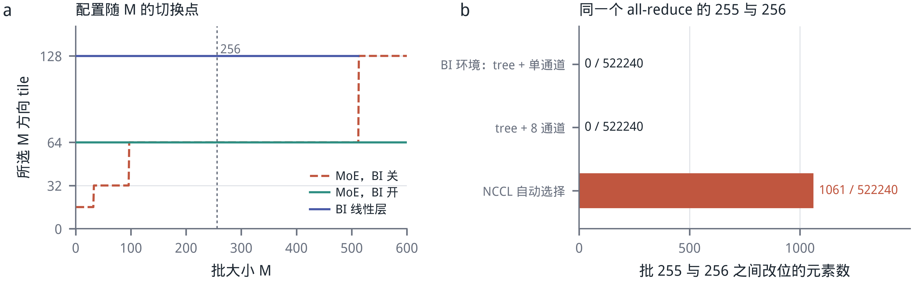
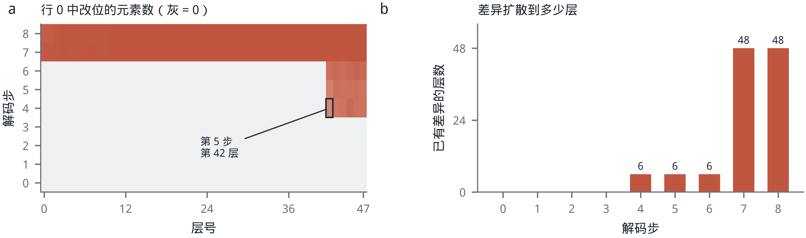

# 9. 算子与配置打点：把每个算子和配置逐项测出来

第 8 章排掉了跨卡归约的算法选择、CUDA graph 分桶和 tail 单调性，剩下的解释是
“模型侧 kernel 按形状选 tile 或 split”。这一章直接测这一句：先看 BI 到底钉住了
什么，再把每个算子单独拿出来跑 255 与 256，最后回到引擎里逐层打点。

结论先说，三条：

- **tile 配置不是原因**。BI 的线性层在 1 到 512 的每个 M 上都用同一套
  BLOCK_M/N/K；MoE 的默认配置在 BI 下也是常数，不开 BI 时的切换点是
  33/65/97/129/513，没有 256。
- **每个算子单独跑都不变**。线性层、两种 RMSNorm、silu、rotary、MoE、
  分页 decode attention，行 0 在 255 与 256 上逐位相同。引擎自带的 pynccl
  通信器在 BI 的环境下也是 299 步一步都不变。
- **差异只出现在引擎里，而且位置固定**。同一批 256 条跑两遍逐位相同，与 255
  差在一处：第 5 个解码步、第 42 层的 input_layernorm 输出。这一层的输入逐位
  相同，输出有 25 个元素不同。

## 9.1 方法

| 检查 | 脚本 | 加载模型 | 墙钟 |
|---|---|---|---|
| BI 覆盖面与配置扫描 | `bi_bi_coverage.py` | 否 | 约 3 分钟 |
| 线性层单独跑 | `bi_matmul_shape.py` | 否 | 40 秒 |
| 其余算子单独跑 | `bi_op_shape.py` | 否 | 1 分钟 |
| 分页 attention 单独跑 | `bi_attn_shape.py` | 否 | 1 分钟 |
| 引擎通信器探针 | `bi_pynccl_bench.py` | 否 | 每配置 1 分钟 |
| 逐层打点 | `bi_layer_probe.py` + `bi_hook/sitecustomize.py` | 是 | 4 分钟 |

汇总：`python3 analyze_tier2.py results/tier2`，原始 JSON 在同一目录。

逐层打点用了一个不常见的做法：把 `sitecustomize.py` 放进 `PYTHONPATH`，vLLM
spawn 出来的四个 worker 在启动时都会导入它，于是 `nn.Module.__call__` 在 worker
进程里被包了一层，可以按模块类型记录每层输出的第 0 行。驱动脚本在每次
`generate()` 之前改写一个 `current_tag` 文件，抓到的数据就自动带上运行标签。
整个改动只在进程里，没有动 vLLM 的安装文件。

## 9.2 BI 在 SM86 上到底替换了什么

<figure class="bi-figure" markdown="span">
  
  <figcaption>图 11　a：三条路径的 M 方向 tile 随批大小的变化，虚线是引擎开始
  失败的 256；b：用引擎自己的 pynccl 通信器比较 255 与 256，只有 NCCL 的自动
  算法选择会让结果改位。</figcaption>
</figure>

表 T5 是把 BI 打开之后逐个调用 aten 算子、再从 profiler 里读回来的结果。
`aten::mm`、`addmm`、`matmul`、`linear` 四条都落到同一个 Triton 内核
`matmul_kernel_persistent`；`bmm` 和 `_log_softmax` 各有自己的内核；
`softmax` 与 `mean.dim` 没有专门的 BI 内核，它们的 BI 实现是拿几个 aten
逐元素算子拼出来的，所以 profiler 里看到的是原生内核名。

| aten 算子 | 实际执行的内核 |
|---|---|
| aten::mm | matmul_kernel_persistent |
| aten::addmm | matmul_kernel_persistent |
| aten::matmul | matmul_kernel_persistent |
| aten::linear | matmul_kernel_persistent |
| aten::softmax | aten 逐元素内核（由几个 aten 算子拼成） |
| aten::_log_softmax | _log_softmax_kernel |
| aten::mean.dim | aten 逐元素内核（由几个 aten 算子拼成） |
| aten::bmm | bmm_kernel |

源码里还有一条本章后面要用到的事实：Ampere 与 Hopper 走的是两条不同的 BI
路径。SM80 没有 cuBLASLt 的确定性保证，所以 vLLM 干脆把
`mm/addmm/matmul/linear` 四条 dispatcher 换成 Triton 常驻内核；SM90 及以上
只用 `CUBLAS_WORKSPACE_CONFIG` 关掉 split-k。这台机器是 SM86，走前一条。

## 9.3 tile 配置不随 M 变

`matmul_persistent` 的配置字典是按 dtype 写的常量，与 M 无关：

```python
configs = {
    torch.bfloat16: {"BLOCK_SIZE_M": 128, "BLOCK_SIZE_N": 128,
                     "BLOCK_SIZE_K": 64, "GROUP_SIZE_M": 8,
                     "num_stages": 3, "num_warps": 8},
    ...
}
```

把内核的启动参数拦下来实测，M 从 1 走到 512，配置一直是这一套，不同配置数
1（表 T6）。变化的只有 grid：`min(84, ceil(M/128) × ceil(N/128))`，也就是
每个 CTA 处理一个输出块，谁处理哪一块不影响每一行的加法顺序。

| 形状 | K | N | 测过的 M 个数 | 行 0 改位的 M 个数 |
|---|---|---|---|---|
| qkv（每卡） | 2048 | 1280 | 12 | 0 |
| o_proj | 2048 | 2048 | 12 | 0 |
| lm_head | 2048 | 151936 | 12 | 0 |

MoE 这一侧更能说明问题。`get_default_config` 在 BI 打开时直接返回常量
64/64/32；把 BI 关掉，启发式会按 M 选 tile，切换点在 33、65、97、129、513，
**没有 256**。

| VLLM_BATCH_INVARIANT | 切换次数 | 切换发生在 M | 255 时的配置 | 255 与 256 相同 |
|---|---|---|---|---|
| 开 | 0 | 无 | 64/64/32 | 是 |
| 关 | 5 | 33, 65, 97, 129, 513 | 64/128/64 | 是 |

所以“256 正好是某个 tile 的边界”这条，在 vLLM 0.23.0 上不成立。第 10 章
F1 与机制总结里把 256 当成 matmul tile 边界的写法需要改，原因见 9.8。

## 9.4 BI 自己就把 NCCL 钉死了

这条是回头补第 8 章用的。`init_batch_invariance()` 会调用
`override_envs_for_invariance()`，后者在 worker 初始化时**无条件**写一批
NCCL 环境变量，位置在 `init_distributed_environment()` 之前：

| 变量 | 值 |
|---|---|
| `NCCL_ALGO` | allreduce:tree |
| `NCCL_PROTO` | Simple |
| `NCCL_MIN_NCHANNELS` | 1 |
| `NCCL_MAX_NCHANNELS` | 1 |
| `NCCL_NVLS_ENABLE` | 0 |
| `VLLM_ALLREDUCE_USE_SYMM_MEM` | 0 |

写进去之前用户设的是 `NCCL_ALGO=None`。也就是说，只要开了 BI，外部再设
`NCCL_ALGO=allreduce:ring` 也会被覆盖掉。

第 8 章 8.3 那张表要按这条更正：三行“不指定 / allreduce:ring /
allreduce:tree”实际跑的是同一套 NCCL 设置，1/32 与 2/32 的差别是重复运行的
噪声，不是算法切换的效果。“钉死算法不能修复 eager 的失败”仍然成立，但原因
是它本来就钉着，而不是钉了没用。

## 9.5 用引擎自己的通信器重做 all-reduce 探针

第 8 章用的是 `torch.distributed` 默认的 NCCL 通信器，引擎用的不是它。这一
节用 vLLM 自己的 `PyNcclCommunicator`，把 BI 的环境变量原样设进去，再按
第 8 章的脚本走一遍 b=1 到 300（表 T9）。

| 运行 | NCCL_ALGO | 通道数 | 299 步里改位的步数 | 255 与 256 改位元素 | 同一批重复 |
|---|---|---|---|---|---|
| BI 环境 | allreduce:tree | 1 | 0/299 | 0 / 522240 | 0 |
| tree，8 通道 | allreduce:tree | 8 | 30/299 | 0 / 522240 | 0 |
| NCCL 自动选择 | 自动 | 默认 | 299/299 | 1061 / 522240 | 0 |

三点读法：

- BI 的环境下，批大小从 1 加到 300，没变的那些行一位都没动；同一批跑两次也
  完全相同。这就是第 8 章想证明、但当时没条件证明的那件事。
- 把通道数放到 8、算法仍然是 tree，299 步里有 30 步改位，但 255 与 256 之间
  还是 0。第 8 章里“树算法仍有 46 步改位”的观察，来源更可能是通道数（那次
  探针用的是 torch 默认通信器，通道数没有限制），而不是算法本身。
- 只有让 NCCL 自己挑算法，255 与 256 才分家：1061 个元素改位。在测过的部件
  里，这是唯一一个恰好在 255→256 变化的位置，而 BI 已经把这条路关掉了。

## 9.6 每个算子单独跑都不变

把这一层里用到的算子逐个拿出来，输入用 300 行、前 255 行与 256 行完全相同，
比较行 0 的位模式（表 T10）：

| 算子 | 测过的批大小个数 | 行 0 变位的个数 | 每行元素 |
|---|---|---|---|
| rms_norm | 8 | 0 | 2048 |
| fused_add_rms_norm | 8 | 0 | 2048 |
| silu_and_mul | 8 | 0 | 4096 |
| rotary_embedding | 8 | 0 | 4096 |
| fused_experts | 8 | 0 | 2048 |
| paged decode attention | 16 | 0 | 1024 |

批大小取 1、64、128、192、254、256、257、300，基准是 255；线性层另测了三组
形状（表 T6，12 个 M 全部 0）。分页 attention 按 vLLM 的调用方式搭的：
每序列 1 个 query、分页 KV、`num_splits=1`，KV 长度取 11/16/31/32，序列数
1 到 300。

另外两个对照也顺手做了：把 `fused_add_rms_norm` 的输入挪到不同的
storage offset（0/1/2/4/8 个元素），行 0 仍然逐位相同；这说明对齐没有改变
向量化路径。

## 9.7 回到引擎：差异是确定的，位置固定

| 比较 | 捕获次数 | 改位的模块数 | 首个改位的模块 | 幅度 |
|---|---|---|---|---|
| 256 与 256（重复） | 4340 | 0 | — | — |
| 256 与 255 | 4340 | 1028 | RMSNorm | 25/2048（1.95e-03） |

同一批 256 条请求跑两遍，4340 次模块调用全部逐位相同；换成 255 条，从第 5
个解码步、第 42 层的 input_layernorm 开始出现差异，之后每一层都不同
（图 12）。这一层的位置是可重复的，不是随机噪声。

<figure class="bi-figure" markdown="span">
  
  <figcaption>图 12　a：行 0 在第几步、第几层开始出现位差（灰为 0，颜色越深
  改位的元素越多）；b：每一步里已有差异的层数。数据来自四个 worker 进程里
  的逐层捕获，比较对象是同一组 prompt 在 256 条与 255 条下的运行。</figcaption>
</figure>

更细的一层：这一处 norm 的输入逐位相同（第 0 行 0 处不同），输出有 25 个
元素不同，位置散在 2048 列里，最大差 2⁻⁹。这个形态说明归一化用的
`1/sqrt(mean(x²)+eps)` 差了一个 ulp，输出按各自舍入，个别元素跨过 bf16 的
边界。下游于是整层整层地分叉，最后第 6 个生成 token 的 logprob 从
−1.0126 变成 −1.1007，token id 仍然相同。

同一个 `fused_add_rms_norm` 在 9.6 里单独跑是逐位相同的。两次调用之间能
想到的差别只剩调用上下文：引擎里这层的张量是多大缓冲区的一段视图，grid 是
256 个 block 而不是 255 个，前后排着别的 kernel。哪一个让结果变了，这一轮
没有测出来，需要抓 kernel 的启动参数（CUPTI/nsys 的 launch 记录）或读
`csrc/layernorm_kernels.cu` 里有没有按 `num_tokens` 分支的路径，而这两样都
不在 site-packages 里。

## 9.8 这一档改写了什么

第 10 章那条机制链是：

1. BI 固定 matmul 的归约顺序；
2. A6000 不在 tuned table 里，内核按 M/N/K 动态选 tile；
3. 形状跨过 256 时配置变化，归约顺序变化，logits 末位不同。

现在第 2、3 条被直接测量否掉了：BI 的内核没有 tuned table，配置是常量；MoE
的候选配置在 256 处也不换。第 1 条仍然成立，而且比原先更强：SM80 上 BI 换的
是整个 dispatcher，不只是“固定归约顺序”。

能站住的收窄后的说法是：

- 255 与 256 在引擎里走的是两套执行上下文，结果确定地不同；
- 这个差别不在任何单个算子的 tile 配置上，也不在跨卡归约上；
- 它第一次可见的位置是某一层 input_layernorm 的输出，而该层的输入逐位相同。

| 第 10 章的说法 | 本档的证据 | 现在怎么写 |
|---|---|---|
| tuned matmul table 覆盖不到 Ampere | 源代码里 SM80 根本不用这张表，改用 Triton 常驻内核 | 方向对，机制写错了 |
| 内核按 M 选 tile，256 是边界 | 配置扫描 1 到 512 只有一套；MoE 的切换点里没有 256 | 删掉 |
| 换 attention/MoE 后端不能修复 | 这些后端都不改 BI 的线性层与 norm | 保留，原因换成“它们共享同一套 BI 覆盖” |
| compiled 走另一套图执行 | 未测 | 保留为推断 |

## 9.9 这一档的局限

- 逐层打点只覆盖 rank 0 的第 0 行，其他 rank、其他行没有比；如果差异在某一行
  上是另一处起源，这里看不到。
- 打点本身会给每个模块调用加一次显存到内存的拷贝，能改变时序；两次 256 的
  结果一致说明它没引入不确定性，但不能排除它改变了分叉出现的位置。
- `bi_op_shape.py` 里的算子用的是合成输入，形状与引擎一致但数值分布不同。
- 只在 vLLM 0.23.0 + SM86 上做了；SM90 的 BI 走另一条路，结论可能不同。

下一步要定位到具体一行，得抓 kernel 启动参数而不是张量：把每个 kernel 的
grid/block/共享内存用量在 255 与 256 两边的序列对齐，看不一致出现在哪一次
launch 上。那需要 CUPTI 或者 nsys，本章没有做。
