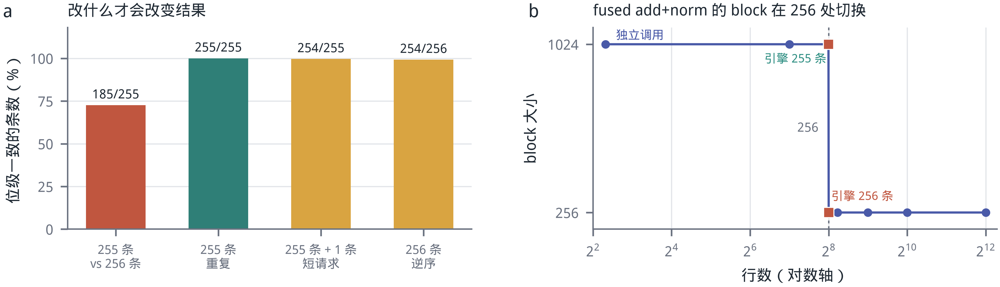
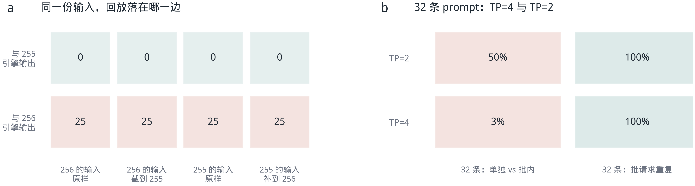

# 10. 第三档：把差异压到一次 kernel 启动

第 9 章停在一句话上：某一层 norm 的第 0 行输入逐位相同，输出却有 25 个元素不同，而同一个
算子单独跑又完全一致。这一章用四个实验继续往里压：改变请求组成、用引擎自己的张量
回放、抓 kernel 启动参数、换 TP=2。四个实验共用一次 GPU 时段，加起来约两小时。

结论有三条：

- **边界只认活跃序列数**。把 256 条逆序、或在 255 条后面加一条只生成一个 token 的
  请求，结果都在噪声底（≤2 条）；只有 255 与 256 相差 70 条。
- **同样的输入，复现不出 256 的输出**。用 256 那次运行捕获的 hidden 与 residual
  重放第 42 层的 norm，四种排布全部落回 255 的结果，与 256 的差恒为 25 个元素。
- **边界上唯一变化的启动参数是 block**。`fused_add_rms_norm_kernel` 在 255 行时
  用 block 1024，从 256 行起换成 256。这个切换在引擎内外都能复现，但只靠它还不够
  解释那 25 个元素。

## 10.1 方法

| 检查 | 脚本 | 是否加载模型 | 墙钟 |
|---|---|---|---|
| 请求组成与逐层捕获 | `bi_composition.py` | 是（一次加载） | 约 3 分钟 |
| 引擎张量回放 | `bi_replay_rmsnorm.py` | 否 | 约 1 分钟 |
| 启动参数对比 | `bi_launch_diff.py`（torch profiler） | 是（一次加载） | 约 6 分钟 |
| TP=2 矩阵 | `bi_tp2_matrix.py` | 是（一次加载） | 约 5 分钟 |

汇总：`python3 analyze_tier3.py results/tier3`。原始 JSON 在同一目录。

逐层捕获沿用第 9 章的注入方式，另外加了两项记录：模块收到的全部参数（hidden 与
residual），以及每个 RMSNorm 调用的 stride、storage offset 和基地址对齐。为了控制
体积，全量张量只在第 2548 次调用前后的一段窗口里保存。

## 10.2 请求组成：顺序和瞬时请求都不重要

同一批 prompt，只改组成，比较每条 prompt 的 logprob 是否逐位相同（表 T12）。

<figure class="bi-figure" markdown="span">
  
  <figcaption>图 13　a：四种组成改动下，255 条共同 prompt 里位级一致的条数；
  红为 255 与 256 的对照，绿为同一配置重复，黄为组成改动。b：fused add+norm
  的 block 随行数变化，蓝线为独立调用，方块为引擎里的实际启动。</figcaption>
</figure>

| 比较 | 条数 | 位级一致 | 首 token 就不同 | 最大 \|Δlogprob\| |
|---|---|---|---|---|
| 255 条 vs 256 条 | 255 | 185/255 | 18 | 7.491e-01 |
| 255 条重复一次 | 255 | 255/255 | 0 | 0.000e+00 |
| 255 条 + 1 条只生成 1 个 token | 255 | 254/255 | 1 | 7.893e-02 |
| 256 条逆序 | 256 | 254/256 | 2 | 1.509e-01 |

读法：

- 255 与 256 差 70 条，最大差 0.75，这是那条边界本身；
- 同一批 255 重复跑两次完全一致，说明 255 这个配置是确定的；
- 把 256 条倒过来提交，只有 2 条改变，说明请求在批内的位置不重要；
- 255 条后面加一条只活一个 token 的请求，也只有 1 条改变。也就是说，第 0 步时
  批里有 256 条、之后剩 255 条，并不触发那条边界。

所以触发条件不是“批里出现过 256 条”，也不是“某条请求排在第几位”，而是**解码
步里同时活跃的序列数**。上一档的逐层打点在这组运行里同样复现：第 5 个解码步、
第 42 层的 norm 输入（hidden 与 residual）逐位相同，输出差 25 个元素。

## 10.3 回放：同样的输入，落在 255 那一边

把那次调用的 hidden、residual、weight、eps 原样拿出来，在独立进程里调用同一个
`fused_add_rms_norm`，换四种排布（表 T13）。

<figure class="bi-figure" markdown="span">
  
  <figcaption>图 14　a：四种输入排布分别与 256、255 两次引擎输出的差异元素数
  （共 2048 个）。b：32 条 prompt 的单独 vs 批内，以及批请求重复，TP=4 与
  TP=2 的位级一致比例。</figcaption>
</figure>

| 输入 | 行数 | 与 256 引擎输出的差异元素 | 与 255 引擎输出的差异元素 |
|---|---|---|---|
| 256 的输入，原样 | 256 | 25 | 0 |
| 256 的输入，截到 255 行 | 255 | 25 | 0 |
| 255 的输入，原样 | 255 | 25 | 0 |
| 255 的输入，补一行到 256 | 256 | 25 | 0 |

四种排布的结果一模一样：全部与 255 的引擎输出逐位相同，与 256 的差都是 25 个
元素。截行、补行都不改变结果，说明这个 kernel 对第 0 行的计算与行数无关——至少
在独立进程里是这样。

这条同时补上了上一档缺的一块证据。第 9 章只比了 hidden，这次把 residual 也比了：
第 2548 次调用的第 0 行，hidden 与 residual 在两套运行里逐位相同，返回的 residual
也相同，只有返回的 hidden 差 25 个元素。整批看，其余 254 行早已不同——这正是
逐层分叉的下游，不影响第 0 行的判断。整批的数也对得上：同一位置 255×2048 的
hidden 有 73432 个元素不同，residual 有 71268 个。

于是问题被压成一句话：第 0 行的输入相同、权重相同、eps 相同，引擎在 256 行时算出
的结果，用同一个算子复现不出来。

## 10.4 profiler：边界上唯一变化的启动参数

用 torch profiler 把两次运行的全部 kernel 启动记录下来，比较 grid、block、
共享内存和寄存器数（表 T14、T15）。

| 运行 | grid | block | 启动次数 |
|---|---|---|---|
| 255 条 | 5 | 1024 | 96 |
| 255 条 | 15 | 1024 | 96 |
| 255 条 | 253 | 1024 | 96 |
| 255 条 | 254 | 1024 | 96 |
| 255 条 | 255 | 1024 | 288 |
| 255 条 | 4344 | 256 | 96 |
| 256 条 | 5 | 1024 | 96 |
| 256 条 | 57 | 1024 | 96 |
| 256 条 | 251 | 1024 | 96 |
| 256 条 | 255 | 1024 | 96 |
| 256 条 | 256 | 256 | 288 |
| 256 条 | 4323 | 256 | 96 |

`fused_add_rms_norm_kernel` 的一个 block 处理一行（共享内存 168 字节、每线程
23 个寄存器，两次运行相同）。区别只在 block 的大小：**grid 小于 256 时 block 是
1024，从 256 起换成 256**。表里那 288 次是六个解码步 × 48 层；其余 96 次是
prefill 的分块。

同一张表里还有一条内部对照：256 那次运行自己也启动过 grid=255、block=1024 的
调用（prefill 的最后一块）。所以切换不是运行级状态，而是按这一次调用的行数决定。

独立调用给出同样的规则（表 T15）：

| 行数 | 5 | 128 | 255 | 256 | 257 | 300 | 512 | 1024 | 4096 |
|---|---|---|---|---|---|---|---|---|---|
| block | 1024 | 1024 | 1024 | 256 | 256 | 256 | 256 | 256 | 256 |

到这里，边界上第一次有了一个离散的、可重复的启动参数变化。

但它还不是完整的答案。回放用的正是 256 行，独立调用在 256 行时同样选了 block 256，
结果却落在 255 那一边。也就是说，block 1024 与 256 对这个输入的第 0 行给出了相同的
位模式，而引擎那边给出的不同。profiler 只暴露 grid、block、共享内存和寄存器数，
kernel 还接收两个标量参数和指针，这些不在 trace 里，剩下的差异只可能藏在它们或
缓冲区状态里。

## 10.5 TP=2：失败率减半，边界还在

两张 A6000 是常见的预算。同一个模型在 TP=2 下的结果（表 T16）：

| 比较 | 位级一致 | 最大 \|Δlogprob\| |
|---|---|---|
| 32 条：单独 vs 批内 | 16/32 | 2.225e+00 |
| 32 条：批请求重复 | 32/32 | 0.000e+00 |
| 255 条 vs 256 条 | 110/255 | 1.360e+00 |
| 256 条重复 | 256/256 | 0.000e+00 |

32 条这一项与第 6 章 TP=4 的 1/32 可以直接比（同为 16 token）：TP=2 把失败率从
31/32 降到 16/32，重复批仍然完全一致，但离 BI 还差一半。255 与 256 之间仍有
145/255 条改变，边界没有消失，只是位置上的幅度不同。

需要说明的是，这一项的 255/256 用了 16 token，和 TP=4 那组 8 token 的 185/255
不能直接对照；能对照的只有 32 条那一行。

## 10.6 这一档改写了什么

| 原来的说法 | 本档的结果 |
|---|---|
| 256 条时某层 norm 的输入相同、输出不同 | 成立，并把 residual 也纳入了比较 |
| 触发条件可能是请求顺序或瞬时批组成 | 否掉：逆序改 2 条，加一条短请求改 1 条 |
| 差异来自输入数值 | 否掉：同样的输入回放不出 256 的结果 |
| 差异来自启动配置 | 找到唯一的变化：block 1024 → 256，但它单独解释不了输出 |
| TP=2 可以作为绕过方案 | 否掉：32 条仍有一半失败 |

现在能写的最窄的一条链是：

1. 解码步里同时活跃 256 条序列时，`fused_add_rms_norm_kernel` 的 block 从 1024
   变成 256，这是边界上唯一可观测的启动参数变化；
2. 第 0 行的输入（hidden、residual、weight、eps）在两次运行之间逐位相同；
3. 引擎在 256 时的输出，用同一个算子、同一份输入复现不出来；
4. 所以还差一个没有被 profiler 记录的量，最可能是 kernel 的标量参数或缓冲区状态。

## 10.7 这一档的局限

- profiler 只给出 grid、block、共享内存与寄存器数，标量参数与指针看不到；
- 全量张量只在一个窗口里保存，窗口按第 9 章的分叉位置选定，换配置后需要重选；
- 255 的重复性在两次运行里分别是 0/255 与 2/255，本档把 2 条当作噪声底；
- TP=2 的 255/256 与 TP=4 不同 token 数，不能直接比较；
- 仍然只覆盖单机、Qwen3-30B-A3B、eager。

复现命令见[第 14 章](14_reproduction.md)。
