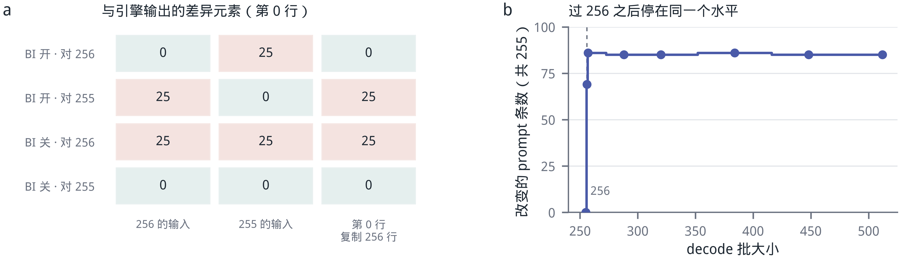

# 10. 把 255/256 的差异压到一次 kernel 启动

第 9 章停在一句话上：某一层 norm 的第 0 行输入逐位相同，输出却有 25 个元素不同，
而同一个算子单独跑又完全一致。这一章把它拆开：先改请求组成、用引擎自己的张量
回放、抓 kernel 启动参数，再扫一遍批大小、换 TP=2、把 compiled 和几个开关一起
对照。全部实验加起来约一个小时 GPU 时间。

结论有五条，第一条推翻了本报告上一版的说法：

- **边界只认活跃序列数**。256 条逆序只改 2 条，255 条后面加一条只生成一个 token
  的请求只改 1 条；255 与 256 相差 70 条。
- **同样的输入能复现 256 的输出**。上一版写“复现不出”，是因为回放进程没有开
  `VLLM_BATCH_INVARIANT`，跑的是向量化内核 `<bf16, 8>`；引擎跑的是标量内核
  `<bf16, 0>`。把 BI 打开后，256 与 255 两次运行的回放各自逐位吻合。
- **BI 开着时，唯一的启动差异是 block**。255 行用 1024 个线程，从 256 行起换成
  256 个；标量内核的归约树随线程数变，第 0 行 25 个元素差一个 ulp。
- **边界是台阶**。257 到 512 都停在同一水平（约 85/255 条改变），没有随批大小
  继续恶化。
- **compiled 在这几档批大小上全部一致**；关掉 breakable CUDA graph 对 eager 没有
  影响；eager 的失败比例则随 prompt 集变化，不是固定值。

## 10.1 方法

| 检查 | 脚本 | 是否加载模型 | 墙钟 |
|---|---|---|---|
| 请求组成与逐层捕获 | `bi_composition.py` | 是（一次加载） | 约 3 分钟 |
| 引擎进程内回放 | `bi_inproc_replay.py` | 是（一次加载，两次运行） | 约 1 分钟 |
| 独立进程回放与内核比对 | `bi_replay_probe.py` | 否 | 每次约 30 秒 |
| 批大小扫描 | `bi_boundary_sweep.py` | 是 | 约 1 分钟 |
| 形状矩阵（eager / 关图 / compiled） | `bi_shape_matrix.py` | 是 | 每配置 1–2 分钟 |
| prompt 集对照 | `bi_prompt_control.py` | 是 | 约 2 分钟 |
| 启动参数对比 | `bi_launch_diff.py`（torch profiler） | 是 | 约 6 分钟 |
| TP=2 矩阵 | `bi_tp2_matrix.py` | 是 | 约 5 分钟 |

汇总：`python3 analyze_tier3.py results/tier3` 与
`python3 analyze_tier4.py results/tier4`，原始 JSON 在同一目录。

逐层捕获沿用第 9 章的注入方式，另外记录模块收到的全部参数、每个 RMSNorm 调用的
stride/offset/基地址对齐，以及（在指定调用上）在 worker 进程里把这次 norm 再算
一遍。独立进程的回放则用 torch profiler 记录它实际启动的内核实例和 grid/block。

!!! note "一处更正"

    上一版 10.3 说“同样的输入，复现不出 256 的输出”，并据此推断差异藏在
    profiler 看不到的标量参数里。那条推断不成立：回放脚本没有设
    `VLLM_BATCH_INVARIANT`，所以调用的是向量化实例，而引擎用的是标量实例。
    下面的 10.3 用两组对照把这件事拆清楚；上一版那张回放表（T13）仍保留在
    `results/tier3/analysis_tables.md` 里，作为“BI 关”的对照。

## 10.2 请求组成：顺序和瞬时请求都不重要

同一批 prompt，只改组成，比较每条 prompt 的 logprob 是否逐位相同（表 T12）。

<figure class="bi-figure" markdown="span">
  
  <figcaption>图 13　a：四种组成改动下，255 条共同 prompt 里位级一致的条数；
  红为 255 与 256 的对照，绿为同一配置重复，黄为组成改动。b：fused add+norm
  的 block 随行数变化，蓝线为独立调用，方块为引擎里的实际启动。</figcaption>
</figure>

| 比较 | 条数 | 位级一致 | 首 token 就不同 | 最大 \|Δlogprob\| |
|---|---|---|---|---|
| 255 条 vs 256 条 | 255 | 185/255 | 18 | 7.491e-01 |
| 255 条重复一次 | 255 | 255/255 | 0 | 0.000e+00 |
| 255 条 + 1 条只生成 1 个 token | 255 | 254/255 | 1 | 7.893e-02 |
| 256 条逆序 | 256 | 254/256 | 2 | 1.509e-01 |

读法：

- 255 与 256 差 70 条，最大差 0.75，这是那条边界本身；
- 同一批 255 重复跑两次完全一致，说明 255 这个配置是确定的；
- 把 256 条倒过来提交，只有 2 条改变，说明请求在批内的位置不重要；
- 255 条后面加一条只活一个 token 的请求，也只有 1 条改变。也就是说，第 0 步时
  批里有 256 条、之后剩 255 条，并不触发那条边界。

所以触发条件不是“批里出现过 256 条”，也不是“某条请求排在第几位”，而是**解码
步里同时活跃的序列数**。

## 10.3 回放：先分清两个内核实例

第 9 章找到的第一个分叉点是第 5 个解码步、第 42 层的 input_layernorm 输出：第 0 行
的 hidden 与 residual 输入逐位相同，输出差 25 个元素。整批看，其余 254 行在这个
位置早已分叉，所以下面的比较只看第 0 行。

先在没有模型的进程里做三组回放：256 次的输入原样、255 次的输入原样、以及把第 0
行复制成 256 行。每组各跑两种环境，一种设 `VLLM_BATCH_INVARIANT=1`，一种不设，
再从 profiler 里读回它实际启动的内核（表 T17、图 14a）。

| 环境 | 输入 | 行数 | 与 256 引擎输出差 | 与 255 引擎输出差 | 内核 | grid | block |
|---|---|---|---|---|---|---|---|
| BI 关 | 256 的输入 | 256 | 25 | 0 | `<bf16, 8>` | 256 | 256 |
| BI 关 | 255 的输入 | 255 | 25 | 0 | `<bf16, 8>` | 255 | 1024 |
| BI 关 | 第 0 行复制 256 行 | 256 | 25 | 0 | `<bf16, 8>` | 256 | 256 |
| BI 开 | 256 的输入 | 256 | **0** | 25 | `<bf16, 0>` | 256 | 256 |
| BI 开 | 255 的输入 | 255 | 25 | **0** | `<bf16, 0>` | 255 | 1024 |
| BI 开 | 第 0 行复制 256 行 | 256 | **0** | 25 | `<bf16, 0>` | 256 | 256 |

<figure class="bi-figure" markdown="span">
  
  <figcaption>图 14　a：三组输入分别在 BI 开、关两种环境下与两次引擎输出的差异
  元素数（第 0 行，共 2048 个）。b：decode 批大小从 255 扫到 512，与 255 基线
  相比改变的 prompt 条数（共 255 条）。</figcaption>
</figure>

三点读法：

- BI 关时三次回放全部落在 255 那一边，这正是上一版看到的现象；
- BI 开时，256 行的两组输入复现 256 的运行、255 行的输入复现 255 的运行，逐位
  吻合，说明输入、权重、eps 都是完整的解释变量；
- 把第 0 行复制成 256 行，结果仍与 256 的运行一致，说明其余 255 行不影响第 0 行
  的计算——这个 kernel 每行独立。

引擎进程内的回放给了同一答案的另一半：在 worker 里于第 2548 次调用现场再算一遍，
256 与 255 两次运行的结果都与引擎输出逐位相同，第 0 行 0 个元素不同，全量
0 个，返回的 residual 也是 0 个。

于是问题从“复现不出来”变成一句可以继续追的话：**第 0 行的数据没变，行数从 255
变成 256，结果就变了；而这次调用唯一改变的是启动形状**。

## 10.4 启动参数：block 在 256 行处换档

用 torch profiler 把两次运行的全部 kernel 启动记录下来，比较 grid、block、
共享内存和寄存器数（表 T14、T15）。

| 运行 | grid | block | 启动次数 |
|---|---|---|---|
| 255 条 | 5 | 1024 | 96 |
| 255 条 | 15 | 1024 | 96 |
| 255 条 | 253 | 1024 | 96 |
| 255 条 | 254 | 1024 | 96 |
| 255 条 | 255 | 1024 | 288 |
| 255 条 | 4344 | 256 | 96 |
| 256 条 | 5 | 1024 | 96 |
| 256 条 | 57 | 1024 | 96 |
| 256 条 | 251 | 1024 | 96 |
| 256 条 | 255 | 1024 | 96 |
| 256 条 | 256 | 256 | 288 |
| 256 条 | 4323 | 256 | 96 |

`fused_add_rms_norm_kernel` 的一个 block 处理一行（共享内存 168 字节、每线程
23 个寄存器，两次运行相同）。区别只在 block 的大小：**grid 小于 256 时 block 是
1024，从 256 起换成 256**。表里那 288 次是六个解码步 × 48 层；其余 96 次是
prefill 的分块。

同一张表里还有一条内部对照：256 那次运行自己也启动过 grid=255、block=1024 的
调用（prefill 的最后一块）。所以切换不是运行级状态，而是按这一次调用的行数决定。

独立调用给出同样的规则（表 T15）：

| 行数 | 5 | 128 | 255 | 256 | 257 | 300 | 512 | 1024 | 4096 |
|---|---|---|---|---|---|---|---|---|---|
| block | 1024 | 1024 | 1024 | 256 | 256 | 256 | 256 | 256 | 256 |

把 10.3 和这一节放在一起，链路就闭合了：

1. BI 打开时，`fused_add_rms_norm` 走标量实例 `<bf16, 0>`；
2. 这个实例的 block 由行数决定，255 行是 1024，256 行是 256；
3. 每行 2048 个元素摊到不同线程数上，平方和的归约树不同，归一化因子差一个 ulp；
4. 第 0 行 2048 个元素里有 25 个跨过 bf16 的舍入边界，下游逐层放大。

同一张表里还有一个反证：BI 关时的向量化实例 `<bf16, 8>` 在 256 行、block 256 下
仍然给出 255 那一边的结果。换档本身不足以解释差异，还要落在标量实例上；上一版
把两者混在一起看，所以走不通。

!!! warning "还差一步"

    行数与 block 在这套代码里是同变的，公开接口没有只改 block 的开关。能说的是
    “第 0 行的数据不变、行数变、block 变、结果变”，以及“其余行不影响第 0 行”；
    要把 block 单独钉死，需要改 vLLM 的启动逻辑，这一轮没有做。

## 10.5 边界是台阶，不是斜坡

既然触发条件是行数跨过 256，接下来看它过了 256 之后怎么走：同一批 prompt 分别
按 255、256、257、288、320、384、448、512 提交，与 255 的基线逐条比较（表 T18、
图 14b）。

| 批大小 | 位级一致 | 改变 | 首 token 就不同 | 最大 \|Δlogprob\| |
|---|---|---|---|---|
| 255 | 255/255 | 0 | 0 | 0 |
| 256 | 186/255 | 69 | 18 | 7.491e-01 |
| 257 | 169/255 | 86 | 17 | 7.491e-01 |
| 288 | 170/255 | 85 | 16 | 7.491e-01 |
| 320 | 170/255 | 85 | 16 | 7.491e-01 |
| 384 | 169/255 | 86 | 17 | 7.491e-01 |
| 448 | 170/255 | 85 | 16 | 7.491e-01 |
| 512 | 170/255 | 85 | 16 | 7.491e-01 |

一步跨过 256，之后停在同一个水平（85 或 86 条），没有随批大小继续恶化。这跟
“block 换一次档”的形状一致：1024 到 256 只换一次，再往上没有第二个台阶。

第 8 章的缓存 tail 扫描里 448 也分过叉，当时被当成另一个可疑点；在这里 448 与
512 一样，都只是过了 256 之后的一员。

## 10.6 TP=2：失败率减半，边界还在

两张 A6000 是常见的预算。同一个模型在 TP=2 下的结果（表 T16）：

| 比较 | 位级一致 | 最大 \|Δlogprob\| |
|---|---|---|
| 32 条：单独 vs 批内 | 16/32 | 2.225e+00 |
| 32 条：批请求重复 | 32/32 | 0.000e+00 |
| 255 条 vs 256 条 | 110/255 | 1.360e+00 |
| 256 条重复 | 256/256 | 0.000e+00 |

32 条这一项与第 6 章 TP=4 的 1/32 可以直接比（同为 16 token）：TP=2 把失败率从
31/32 降到 16/32，重复批仍然完全一致，但离 BI 还差一半。255 与 256 之间仍有
145/255 条改变，边界没有消失，只是位置上的幅度不同。

需要说明的是，这一项的 255/256 用了 16 token，和 TP=4 那组 8 token 的 185/255
不能直接对照；能对照的只有 32 条那一行。

## 10.7 部署侧对照：compiled、breakable graph、prompt 集

同一套形状矩阵在三套环境里各跑一遍（表 T19）：

| 配置 | 32 条单独 vs 批内 | 256 vs 255 | 448 vs 255 | 512 vs 255 |
|---|---|---|---|---|
| eager（默认） | 24/32 | 187/255 | 170/255 | 170/255 |
| eager + `VLLM_USE_BREAKABLE_CUDAGRAPH=0` | 24/32 | 186/255 | 169/255 | 168/255 |
| compiled | 32/32 | 255/255 | 255/255 | 255/255 |

两点：

- **compiled 在 448 与 512 上同样一致**。上一版只测到 256，这里的补测说明那条
  “唯一通过的配置”没有隐藏的形状缺口。
- **breakable CUDA graph 这个开关对 eager 没有影响**（差异在 1–2 条，属于重复
  运行的噪声）。eager 本来就关掉了 CUDA graph，这个结果符合预期。

还有一个必须写清楚的对照。本章 32 条这一项用的是 32 条问答 prompt、8 token；第 6
章用 target + 31 条 filler、16 token，当时只有 1/32 一致。为了确认差别来自哪里，
把两组 prompt 在同一个进程里各跑一遍（表 T20）：

| prompt 集 | max_tokens | 位级一致 | 最大 \|Δlogprob\| |
|---|---|---|---|
| target + 31 条 filler | 16 | 2/32 | 2.723 |
| 32 条问答 prompt | 16 | 24/32 | 1.333 |
| target + 31 条 filler | 8 | 1/32 | 2.361 |

所以“eager 32 条里只过 1 条”这个数字是那组 prompt 的性质，不是 eager 的固定
失败率：换一组普通的问答 prompt，同一台机器、同一个进程，eager 只坏 8 条。
部署时按自己的 prompt 集验证，不能引用一个通用比例。

## 10.8 这一档改写了什么

| 原来的说法 | 本档的结果 |
|---|---|
| 256 条时某层 norm 的输入相同、输出不同 | 成立，并确认只有第 0 行相同，其余行早已分叉 |
| 触发条件可能是请求顺序或瞬时批组成 | 否掉：逆序改 2 条，加一条短请求改 1 条 |
| 差异来自输入数值 | 否掉：第 0 行数据相同，复制成 256 行结果也不变 |
| 同样的输入回放不出 256 的输出 | **否掉**：回放进程没开 BI，跑的是另一个内核实例；开着 BI 时两次运行都能复现 |
| 差异来自启动配置，但 block 单独解释不通 | 更新：BI 下标量内核的 block 在 256 行处从 1024 换成 256，归约树随之改变 |
| TP=2 可以作为绕过方案 | 否掉：32 条仍有一半失败 |
| eager 的 32 条失败率是一个固定数字 | 否掉：随 prompt 集从 1/32 变到 24/32 |

现在能写的最窄的一条链是：

1. 解码步里同时活跃的序列数跨过 256 时，`fused_add_rms_norm_kernel` 的 block
   从 1024 变成 256；
2. BI 打开时这个算子走标量实例，其平方和归约随线程数变化；
3. 第 0 行的输入在两套运行之间逐位相同，输出差 25 个元素（≤2⁻⁹）；
4. 这点差异逐层放大，最后改变个别 token 的 logprob；
5. compiled 路径不受影响；TP=2 只是把失败率减半。

## 10.9 这一档的局限

- 行数与 block 同变，没有单独改 block 的开关，因果链的最后一步仍是推断；
- `bi_replay_probe.py` 只比了第 42 层那一处调用，其他层没有逐个回放；
- 全量张量只在一个窗口里保存，窗口按第 9 章的分叉位置选定，换配置后需要重选；
- 255 的重复性在两次运行里分别是 0/255 与 2/255，本档把 2 条当作噪声底；
- TP=2 的 255/256 与 TP=4 不同 token 数，不能直接比较；
- Nsight Systems 2023.2 在这套 CUDA 12.9 + 多进程 worker 的组合下无法完成引擎
  初始化（gloo 连接被对端关闭），本轮没有拿到 nsys 时间线；
- 仍然只覆盖单机、Qwen3-30B-A3B、eager。

复现命令见[第 14 章](14_reproduction.md)。
