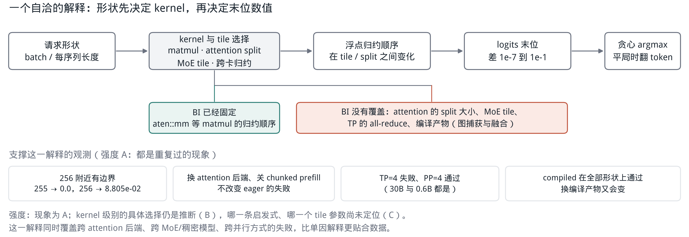

# 11. 关键发现与解释

每条发现给出：事实、证据、解释强度。解释强度按 [01](01_scope.md) 的 A/B/C 分级。

---

## F1. eager 的 BI 不是“开开关就成立”，而是有形状边界

**事实**：在 4×A6000 + vLLM 0.23.0 + Qwen3-30B-A3B 上，eager 模式：

- bs ≤255（decode，target-only）：0.0；
- bs ≥256：logprob 从第 5 个生成 token 开始偏离，最大 8.805e-02；
- 32 条普通 prompt（总 prefill 约 483 token）单次批量提交：只有 1/32 通过；
- 单步 prefill 253 token：32/32 通过；284 token：1/32；
- 16 条 ×30 token（455）：2/16；8 条 ×40（285）：8/8。

**证据**：表 I、J、N、P；多次重复、跨进程一致。

**解释**：BI 覆盖了 `aten::mm` 等算子，但没有覆盖所有 fused kernel 的
形状相关选择。vLLM 在 eager 下按 batch/seqlen 选择 FlashAttention/TRITON
attention 的 tile/split 配置；MoE 的 `fused_moe_kernel` 也按 expert token
数选择 tile。阈值附近换配置，归约顺序变化，logits 就不再逐 bit 相同。

官方文档还提供了一个背景：BI 的 tuned matmul 表只覆盖 Ada/Hopper/Blackwell；
A6000 是 Ampere（SM86），名义上满足 CC≥8.0，但不在 tuned 路径里。这解释了
为什么“官方 tested model + 官方支持 CC”仍会在本机出现形状相关的失败。

!!! note "第 9 章更正"

    上面这段“按形状选 tile”的解释，在第 9 章被直接测量否掉了。vLLM 0.23.0
    在 SM86 上根本不用 tuned matmul 表，而是把 `mm/addmm/matmul/linear`
    换成 Triton 常驻内核，配置是常量；MoE 在 BI 下的配置也是常量，不开 BI
    时的切换点里没有 256。单个算子单独跑 255 与 256 也全部逐位相同。差异
    只在引擎里出现，第一次可见的位置是某一层 input_layernorm 的输出。第 10 章
    继续压了一步：边界只认活跃序列数；BI 打开时 fused add+norm 走标量实例，
    它的 block 恰好在 256 行处从 1024 变成 256，第 0 行的 25 个元素就是这一步
    带出来的。

[第 8 章](08_mechanism_checks.md)用三个独立实验缩小了候选范围：把 NCCL
算法钉死（`allreduce:ring` / `allreduce:tree`）不改变失败数量，CUDA graph
的分桶边界（32/64/128）上 eager 也没有台阶，因此这两条解释被排除，剩下的
是模型侧 kernel 按形状选配置。

**强度**：A（现象）；B（机制，尚未逐 kernel 打点确认）。

---

## F2. v1 的“短 prompt 全 0”是 target-only 测试假象

**事实**：v1 的短 prompt 只有一条 5-token target。v2 对同样的 32 条 prompt
逐条比较：

- prompt0（target）：单独 vs 批内 0.0；
- prompt1–31：31 条不一致，部分 token id 改变。

**证据**：表 M、P；在线与离线各自复现；3 个独立服务进程的 solo 输出一致，
说明不是服务随机性。离线复核：31/32 不一致，两次相同批请求之间 1 条不一致。

**解释**：target 的 5-token 序列在 prefill 中落入一条数值路径，恰好与单独
prefill 相同；更长的 filler（约 10–12 token）落入另一条路径。v1 只测 target，
因此看到了“全 0”。

**强度**：A。这是本报告最重要的方法论更正。

---

## F3. prefix cache 不是 eager 短 prompt 失败的原因

**事实**：bs256 的 PC0 与 PC1 数值完全相同；短 prompt 的 cache hit 在
eager/compiled 都是 0.0；把 PC 关掉不能修复 32-prompt 的 31/32 失败。

**证据**：表 J；v1 表 E。

**解释**：缓存命中改变的是“是否复用 KV”，不改变 kernel 形状选择；短 prompt
的命中路径与 fresh 路径恰好一致。长 prompt 是例外（F4）。

**强度**：A。

---

## F4. eager + 长 prompt + 缓存命中可能改变输出

**事实**：

- 7600-token 饱和 prompt：fresh vs hit 最大 2.384e-07（TP4）/4.768e-07（TP2）；
- 7584-token 开放结尾 prompt：首个生成 token 的 logprob 差 0.597，token 翻转；
- 8180-token 近最大上下文：PC0/PC1 都恰好 0.0。

**证据**：v1 表 E/H；v2 表 K；三次重复。

**解释**：缓存命中后只剩一个很短的 tail 需要 prefill；tail 的 chunk 形状与
full prefill 不同，attention 的 tile/split 选择随之不同。是否分叉取决于
tail 长度落在哪种 chunk 形状上，因此 7600 坏、8180 好。

第 8 章把 tail 长度从 1 扫到 512：只有 256 与 448 分叉，320、384、512 又
回到 0.0。所以这条不能读成“tail 越长越容易坏”，只能读成“某些 tail 长度会
命中不同的 chunk 形状”。分叉幅度 10⁻⁷ 到 10⁻⁶，token id 一次都没变。

**强度**：A（现象）；B（几何解释）。

---

## F5. compiled 模式在进程内通过了全部测试

**事实**：compiled（不加 `--enforce-eager`）在以下测试全部 0.0：

- 32 条 prompt 单独 vs 批内；
- N=8/16/32（含总 prefill 160/253/284/455）；
- bs=256，含 256-token 生成；
- 256-token decode vs re-feed；
- 32 路独立并发、突发、背景解码、混合插入；
- 重复批请求；
- 跨 3 个 warm-cache 进程的 solo 基线。

**证据**：表 J、M、N、O、P；多次重复。

**解释**：`torch.compile` + CUDA Graphs 走另一套 kernel/图执行路径，形状选择
更稳定；具体是 Inductor 融合、图捕获 padding 还是 attention 后端选择，尚未
逐项确认。

**强度**：A（现象）；C（机制）。

---

## F6. compiled 与 eager 的输出不同，不能混用

**事实**：

- target：首 token 不同，最大 logprob 差约 1.57e-01；
- 32 条 prompt 的 solo 基线：compiled vs eager 32/32 不同；
- compiled 与 eager 各自跨进程稳定（各自 32/32 相同）。

**证据**：表 L、P；3 个服务进程互比。

**解释**：两种模式的 kernel 路径不同，数值结果不同；但各自是确定的。

**强度**：A。

**部署含义**：要么全用 compiled，要么全用 eager；不要把两种模式的日志、
分数、RL rollout 混在一个实验里。

---

## F7. compiled 的冷编译/缓存状态会改变输出

**事实**（v1）：

- compiled 同配置 cold vs warm：target 第 10 位 logprob 不同，第 14 位 argmax
  翻转，最大差 1.227；
- warm #2 vs #3：0.0；
- chunk 8192 vs 2048（均 warm）：最大差 1.227，token 序列改变。

**证据**：v1 表 B/D；生成文本示例。

**解释**：torch.compile 的图/内核选择受缓存、chunk 形状、编译选项影响；
不同编译产物是不同数值函数。

**强度**：A（现象）；B（编译状态解释）。

**部署含义**：compiled 的“BI”只在**固定编译产物**内成立；升级 vLLM/PyTorch、
清缓存、换 chunk size 都要重新验证。

---

## F8. 256 是反复出现的边界数字，但不是唯一条件

**事实**：

- decode：255 一致，256 失败；
- prefill：253 一致，284 失败；
- re-feed：197 一致，261 失败；
- 但 N=8、总 285 一致。

**证据**：表 I、N、O。

**解释**：kernel 的 tile/split 启发式同时看 batch size、每序列长度、总 token；
256 是多个启发式的临界值之一。不能简化成“总 token ≤256 就安全”。

!!! note "第 9 章更正"

    现象部分仍然成立：256 反复出现，但不是唯一条件。解释部分被第 9 章否掉
    了——BI 下线性层与 MoE 的 tile 配置都是常量，分页 attention 在 255 与
    256 上逐位相同。边界跟着批形状走这件事没有变，但触发点不在任何单个算子
    的配置上，目前只知道它落在引擎的执行上下文里。

**强度**：A（现象）；解释待定。

---

## F9. 真实并发不是根因，但会放大问题

**事实**：

- 单次批量请求 32 条：eager 1/32；
- 32 路独立并发：eager 1/32；
- 单个请求插入解码中的批次：4/4 通过；
- compiled 在所有到达方式下 32/32。

**证据**：表 M。

**解释**：失败跟着“批的形状”走，而不是 TCP/线程；并发只是让更多请求进入
同一个大步。单个小请求的混合批次没有跨过形状阈值，所以通过。

**强度**：A。

---

## F10. BI 关闭对照能检测到非 BI 行为

**事实**：BI=0 时短 target 的 bs1 vs bs32 差 6.042e-02（离线）/1.273（在线），
逆序 7.360e-02，decode/refeed 4.201e-02。

**证据**：v1 表 C/G。

**解释**：测试能检测到非 BI 行为；0.0 不是测试太弱。

**强度**：A。

---

## F11. TP size、attention backend、编译模式都是 BI 边界

**事实**：

- TP2 vs TP4：token id 相同，logprob 首 token 差 1.342e-01；
- TRITON_ATTN vs FLASH_ATTN：token id 首 token 分叉，最大 1.334；
- compiled vs eager：首 token 分叉，最大 1.334（v1 口径）。

**证据**：表 L。

**解释**：不同并行切分/attention kernel 的归约顺序不同；BI 不承诺跨这些维度。

**强度**：A。

---

## F12. 环境坑：NCCL 与 FlashInfer sampler

**事实**：

- NCCL 2.28.9 在本机无 IB 时会在 `ncclNetPluginInit` segfault，必须
  `NCCL_IB_DISABLE=1`；
- `ninja` 缺失导致 FlashInfer sampler JIT 失败，需
  `VLLM_USE_FLASHINFER_SAMPLER=0`。

**证据**：启动日志；v1 附录 A。

**解释**：环境问题，不是 BI 语义问题；但不设置就无法稳定跑 TP=4。

**强度**：A。

---

## F13. 换引擎不改变问题结构，跨卡归约才是 SGLang 的分界

**事实**：

- SGLang 0.5.6 的 `--enable-deterministic-inference` 在 TP=4 下只有 7/32 条
  prompt 位级一致，其中 7 条连 token id 都变了；
- 关掉 custom all-reduce、关掉 CUDA graph、把 attention 换成 triton，得到的
  数字分别是 25/32、25/32、17/32（不一致数），前两项与默认完全一样；
- 稠密 Qwen3-0.6B 上，TP=1 与 TP=2 都是 32/32，TP=4 是 0/32，PP=4 是 32/32；
- 30B 换 PP=4 后离线 32/32、在线 96/96，且 CUDA graph 开或关数值相同。

**证据**：第 7 章表 S1、S2、S3 与在线表。

**解释**：TP=4 的跨卡归约在不同批形状下选了不同的归约路径，数值随之变化；
PP 只传激活、不做归约，所以不受影响。F11 从 vLLM 的数据里看到并行切分是
BI 的边界，这一节在 SGLang 上给出了第二组证据。

[第 8 章](08_mechanism_checks.md)的不加载模型探针补上了第三组证据：同一台
机器上，TP=4 的 all-reduce 在批大小从 1 走到 300 的过程中，299 步每一步都会
改变本该不动的那些行；TP=2 一步都不变。把算法钉成 `allreduce:tree` 之后，
bf16 的归约对批大小不再敏感，这正是 SGLang 确定性模式在做的事。

**强度**：B。分界点清楚，归约层面的形状敏感已经独立测到，但具体是哪一层、
哪一次归约造成引擎里的失败，还没有定位。

---

## F14. 256 的边界只认活跃序列数，标量内核在这里换了一次 block

**事实**：

- 255 与 256 之间 70/255 条 prompt 改变；256 条逆序只改 2 条；255 条后加一条
  只生成一个 token 的请求只改 1 条；同一批 255 重复运行 0 条改变；
- 同一份输入在独立进程里回放：设了 `VLLM_BATCH_INVARIANT=1` 时，256 行与 255
  行各自复现对应运行的输出（0 个元素不同）；不设时两次都落在 255 那一边。两次
  调用的内核实例分别是 `<bf16, 0>` 与 `<bf16, 8>`；
- 把第 0 行复制成 256 行再回放，结果与 256 的运行一致，说明其余行不影响第 0 行；
- profiler：`fused_add_rms_norm_kernel` 在 grid 小于 256 时 block 为 1024，
  从 256 起换成 256；256 那次运行自己的 prefill 尾块（grid=255）仍是 1024；
- 引擎进程内现场回放，256 与 255 两次运行都与引擎输出逐位相同（全量 0 个不同）；
- 257 到 512 的批大小停在同一个失败水平（约 85/255 条）；
- compiled 在 255/256/448/512 上全部一致；关掉 breakable CUDA graph 对 eager
  没有影响；eager 的 32 条失败率随 prompt 集从 1/32 变到 24/32。

**证据**：第 10 章表 T12–T20，图 13、图 14。

**解释**：触发条件是解码步里同时活跃的序列数。BI 打开时这个算子走标量实例，
它的 block 由行数决定；跨过 256 行，每行的 2048 个元素摊到 256 个线程而不是
1024 个，平方和的归约树改变，归一化因子差一个 ulp，第 0 行 25 个元素跨过 bf16
的舍入边界。上一版“回放复现不出 256”的说法，是回放进程没开 BI、跑成了向量化
实例造成的。

**强度**：B+。输入不变、行数变、结果变三者都直接测到，block 与归约的对应关系
有内核实例与线程数作证；差一步的是行数与 block 同变，公开接口不能只改 block。

---

## 机制总结（推断）

原来给的解释是：BI 固定 matmul 的归约顺序，但内核仍按 M/N/K 选 tile，256
跨过边界就换配置。第 9 章把这条拆开测，中间两步都被否掉了。现在能写的是
一条更窄的链：

1. BI 在 SM86 上把 `mm/addmm/matmul/linear` 四条 dispatcher 换成 Triton
   常驻内核，配置是常量，不随 M 变；MoE 的配置与 attention 的 `num_splits`
   在 BI 下同样被钉住；
2. BI 在 worker 初始化时把 NCCL 钉成 tree + Simple + 单通道，位置在通信器
   创建之前，所以外部设 `NCCL_ALGO` 不会生效；
3. 单个算子单独跑，255 与 256 逐位相同；引擎自带的 pynccl 在 BI 环境下
   b=1 到 300 一步都不改位；
4. 整机仍然在 256 上稳定偏离：同一批 256 跑两遍完全一致，与 255 的差异从
   第 42 层 input_layernorm 的输出开始，而这一层第 0 行的输入逐位相同；
5. 第 10 章把这一处定量了：BI 打开时 `fused_add_rms_norm` 走标量实例，
   它的 block 在 255 行是 1024、从 256 行起是 256；同一份第 0 行数据在
   256 行下得到的输出与 255 行差 25 个元素，把这一行复制成 256 行结果不变，
   说明差异来自启动形状而不是数据；
6. 放大方式不变：logits 末位差 → 个别 token 的 logprob 改变 → 接近平局时
   翻 token。

这个链条仍然解释了“换 attention 后端、关 chunked prefill、换 MoE 后端都不能
修复”：它们共享同一套 BI 覆盖，而问题不在被覆盖的那些算子里。

<figure class="bi-figure" markdown="span">
  
  <figcaption>图 15　上面这段解释的结构。两处标注分开说清 BI 覆盖了什么
  （matmul 的归约顺序、attention 的 split、MoE 的配置）与没覆盖什么（TP 的
  all-reduce、编译产物）；底部四个观测分别来自第 4–6 章与第 7 章。第 9 章
  测过了“没覆盖”里最能解释 256 的那一格，结论写在该章 9.8。</figcaption>
</figure>

第 8 章排掉了三个替代解释：NCCL 的算法选择（钉死后失败照旧）、CUDA graph
的分桶（边界两侧 compiled 都是 0.0）、tail 长度单调（只有 256 与 448 分叉）。
同一章也测到跨卡归约本身确实随消息大小改变结果，只是它不是 eager 这条
255/256 边界的来源。

第 10 章把最后这段补上了：请求顺序与瞬时组成都不触发边界，只有解码步里同时
活跃的序列数；开着 BI 的回放能逐位复现 256 与 255 两次运行（不设 BI 时两次
都落回 255，上一版的“复现不出”就是这个原因）；profiler 里唯一随边界变化的
启动参数是 `fused_add_rms_norm_kernel` 的 block（1024 → 256）。剩下的只是
因果链最后一环：行数与 block 同变，公开接口没有办法只改其中一个。
