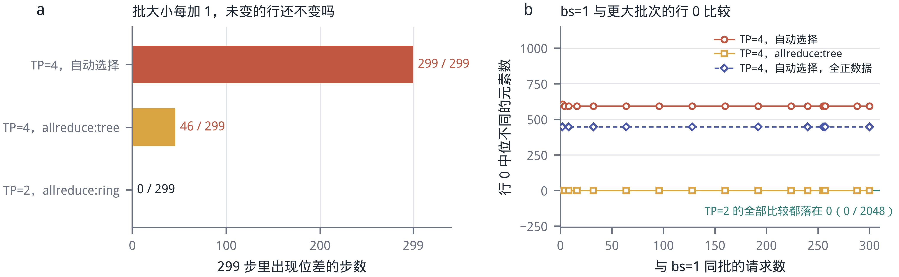
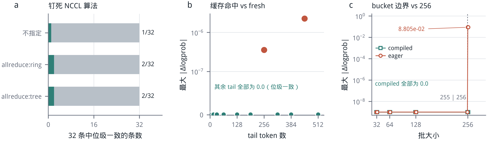

# 13. 机制验证：先做不需要加载模型的检查

第 7 章给出的解释是：请求形状决定 kernel 的 tile/split 配置，配置决定浮点归约
顺序，归约顺序决定 logits 的末位。这条链条上有三件事可以单独证伪：跨卡归约、
NCCL 算法选择、CUDA graph 的形状分桶。本章先测这三件，再加一项前缀缓存的
tail 扫描。四项都不需要改 vLLM 源码，加起来不到十分钟 GPU 时间。

结果：

- TP=4 时把批大小从 1 加到 300，299 步里每一步都会让本该不动的那些行改变
  位；TP=2 时一步都不变；
- 把 NCCL 算法钉死之后，vLLM eager 的 32 条 prompt 从 1/32 变成 2/32，
  最大差仍是 2.723；
- 14 个 tail 长度里只有 256 和 448 分叉，320、384、512 又回到 0.0；
- compiled 在 31/32/33、63/64/65、127/128/129、255/256/257 上全是 0.0，
  eager 只在 256 之后失败，256 与 graph 的分桶边界无关。

## 13.1 方法

| 检查 | 脚本 | 是否加载模型 | 墙钟时间 |
|---|---|---|---|
| all-reduce 形状敏感性 | `bi_allreduce_bench.py` | 否 | 约 1 分钟（含 6 次启动） |
| NCCL 算法对照 | `run_nccl_sweep.sh` | 是（30B TP=4 eager） | 约 4 分钟 |
| tail 长度扫描 | `bi_tail_scan.py` | 是（30B TP=4 eager） | 40 秒 |
| bucket 边界扫描 | `bi_bucket_scan.py` | 是（30B TP=4） | 77 秒 ×2 |

汇总：`python3 analyze_tier1.py results/tier1`，原始 JSON 在
`results/tier1/`。

all-reduce 探针有三个设计上的注意点：

1. **每个 rank 的数据必须不同**。如果四个 rank 持有同样的值，求和等于乘 4，
   而乘 4 是 2 的幂缩放，任何归约顺序都给出同一个位模式，实验就测不出东西。
   探针用 `sin(i·10⁻³ + 0.37·(rank+1))` 生成各 rank 不同的数据。
2. **比较的是没变的那些行**。`[b,H]` 与 `[b+1,H]` 的前 b 行输入完全相同，
   多出来的一行是零。如果归约与消息大小无关，这 b 行的输出位模式必须相同。
3. **H 取 2048**，与 Qwen3-30B-A3B 的 hidden size 一致，bf16 下每行 4096
   字节，批大小 1..300 对应的消息大小与引擎里 decode 阶段同量级。

## 13.2 跨卡归约对消息大小敏感，对形状不敏感

<figure class="bi-figure" markdown="span">
  
  <figcaption>图 10　不加载模型的 all-reduce 探针。a：批大小每加 1，前面那些
  没变的行里有多少元素改了位（299 步的计数）；b：bs=1 单独跑与和更多请求
  同批跑时，第 0 行的位差元素数。虚线是用全正数据重复 b 的对照。</figcaption>
</figure>

| 探针 | TP=4 自动选择 | TP=4 钉成 allreduce:tree | TP=2 |
|---|---|---|---|
| reshape（字节数相同，形状不同） | 全等 | — | 全等 |
| 每加一行（299 步中出现位差的步数） | 299 | 46 | 0 |
| bs=1 vs 更大批次（行 0 的位差元素数） | 593 / 2048 | 0 / 2048 | 0 / 2048 |
| 全正数据对照（行 0） | 447 / 2048 | — | — |
| NCCL 结果 vs fp64 精确和 | 144667 / 1048576 | 157281 / 1048576 | 0 |
| NCCL 结果 vs 按 rank 顺序相加 | 148104 / 1048576 | 167354 / 1048576 | 0 |
| NCCL 结果 vs 按 rank 逆序相加 | 161481 / 1048576 | 108024 / 1048576 | 0 |

四点读法：

- 决定结果的是消息大小，不是形状。同一批字节按 `(256,2048)`、`(128,4096)`、
  `(512,1024)` 送进去，输出逐位相同；把行数从 1 加到 300，每一步都在变。
- TP=4 的自动选择几乎没有重复过：bs=1 与 bs=2 之间已经有 607 个元素改了位，
  之后每一步都在变，说明 NCCL 按消息大小换了分块或协议。
- 钉成 tree 之后 bf16 稳定下来：bs=1 与任何批次的行 0 完全一致，299 步里只剩
  46 步有位差，而且集中在 64→65、128→129、256→257 这种刚过 2 的幂的位置。
  fp32 没这么干净（81 步、349 个元素）。SGLang 在确定性模式里设
  `NCCL_ALGO=allreduce:tree`，效果与这里测到的对上。
- NCCL 的累加顺序既不是 rank 顺序也不是逆序，与 fp64 精确和相比有 14% 的
  元素不同，用的是它自己的分块累加。TP=2 时三者一致，两个数相加没有顺序可挑。

全正数据的对照排掉了另一种解释：换成没有正负抵消的输入，行 0 仍有 447 个
元素改变，所以这些位差不是正负抵消放大出来的。

## 13.3 钉死 NCCL 算法，vLLM 的失败没有跟着消失

| NCCL_ALGO | 32 条位级一致 | token id 变化 | 最大 \|Δlogprob\| | 重复批不一致 |
|---|---|---|---|---|
| 不指定 | 1/32 | 10 | 2.723 | 1 |
| allreduce:ring | 2/32 | 10 | 2.723 | 1 |
| allreduce:tree | 2/32 | 10 | 2.723 | 0 |

13.2 的探针说 bs=1 与 bs=2 的归约结果就该不同，可第 6 章的表 I 里 eager 在
bs≤255 与 bs=1 之间是 0.0。两边不可能同时是引擎的全部真相。启动日志显示
这批服务用的是 pynccl（`disable_custom_all_reduce=True`、
`vLLM is using nccl==2.28.9`），通信器由 vLLM 自己建立，通道数和缓冲注册方式
与探针里 torch 默认的通信器不同。这条差异我们没有定位到底，能站住的只有：

- 事实（A）：把 NCCL 算法钉死，不能修复 eager 的 32-prompt 失败；
- 事实（A）：同一台机器上，NCCL 的自动选择确实随消息大小改变归约结果；
- 推断（B）：引擎内的 TP 归约没有走上表里那条自动选择路径，或者它的消息
  大小不随批形状变化。

NCCL 的算法选择不是 255/256 那条边界的原因，但它是这台机器上真实存在的形状
敏感源。在别的引擎配置下（例如 SGLang TP=4）它可能就是主要来源。

!!! note "第 14 章更正"

    本节的三行“不指定 / allreduce:ring / allreduce:tree”其实是同一套设置。
    BI 在 worker 初始化时会无条件把 `NCCL_ALGO` 写成 `allreduce:tree`，位置
    在 `init_distributed_environment()` 之前，所以外部设的 ring 被覆盖掉了。
    1/32 与 2/32 的差别是重复运行的噪声。第 14 章用引擎自己的 pynccl 通信器
    把这件事重做了一遍：BI 的环境下 299 步一步都不改位，只有让 NCCL 自己挑
    算法时 255 与 256 才分家。

## 13.4 缓存命中的分叉不随 tail 变长

第 7 章 F4 的解释是：命中缓存后只剩很短的 tail 需要 prefill，tail 的 chunk
形状与完整 prefill 不同。这个说法隐含“tail 越长越容易分叉”。扫描的结果不
支持这个单调性。

| tail token | 位级一致 | 首个不一致 | 最大 \|Δlogprob\| | token id 相同 |
|---|---|---|---|---|
| 1, 2, 4, 8, 16, 32, 64, 128, 192 | ✅ | — | 0.0 | ✅ |
| 256 | ❌ | 0 | 3.576e-07 | ✅ |
| 320, 384 | ✅ | — | 0.0 | ✅ |
| 448 | ❌ | 2 | 2.265e-06 | ✅ |
| 512 | ✅ | — | 0.0 | ✅ |

基座 prompt 6000 token，每个 tail 长度各请求两次：第一次缓存为空（fresh），
第二次命中。14 个长度里只有 256 与 448 分叉，320、384、512 又完全一致。
分叉幅度是 10⁻⁷ 到 10⁻⁶，比批形状引起的 10⁻² 小两个数量级，token id
一次都没变。

结论：F4 里“tail 长度与 block 对齐决定分叉”方向仍然成立，但“越长越坏”不成
立，得写成“某些 tail 长度会命中不同的 chunk 形状”。强度 A（现象），B（几何
解释）。

## 13.5 256 不是 CUDA graph 的分桶边界

<figure class="bi-figure" markdown="span">
  
  <figcaption>图 11　a：钉死 NCCL 算法后的 32 条 prompt；b：缓存命中与 fresh
  的差异随 tail 长度；c：compiled 与 eager 在批大小上的差异，虚线标出 eager
  的 255/256 分界。</figcaption>
</figure>

| 批大小 | compiled | eager |
|---|---|---|
| 31, 32, 33 | 0.0 ✅ | 0.0 ✅ |
| 63, 64, 65 | 0.0 ✅ | 0.0 ✅ |
| 127, 128, 129 | 0.0 ✅ | 0.0 ✅ |
| 255 | 0.0 ✅ | 0.0 ✅ |
| 256, 257 | 0.0 ✅ | 8.805e-02 ❌（首个不一致在第 5 个 token） |

CUDA graph 按批大小分桶捕获，桶边界通常在 32、64、128 这类数字上。如果
compiled 的一致性来自桶内 padding 把形状钉死，eager 应当在同样的位置出现
台阶，但它没有；compiled 在 256、257 上也没有变化。

这一组同时补上了 compiled 在 31..129 这段此前没测过的批大小：全部 0.0。

## 13.6 排除之后，还剩下什么

三个候选解释被削弱或排除：

| 候选解释 | 结果 |
|---|---|
| NCCL 按消息大小换归约路径，导致 eager 的 255/256 边界 | 排除：钉死算法后失败照旧 |
| CUDA graph 的分桶形状决定了 compiled 的通过 | 排除：bucket 边界两侧 compiled 都是 0.0 |
| tail 越长，缓存命中越容易分叉 | 排除：只有 256 与 448 分叉，320/384/512 一致 |
| 模型侧 kernel 按形状选 tile/split | 仍然站得住，且是唯一还没被直接测量的 |

跨卡归约这条线仍然有用：它解释了 TP=2 在这台机器上为什么安全（13.2 里
TP=2 的所有比较都是 0），也和第 12 章的两件事对得上：SGLang 要把 TP=4 换成
PP=4 才通过，要把算法钉成 `allreduce:tree` 才让 bf16 归约稳定。

下一步该做的是第二档实验：把 BI 覆盖后的 `matmul_kernel_persistent` 与
attention/MoE kernel 的 tile 配置打印出来，直接看 256 前后换了什么。那需要
改 vLLM 源码或加日志，不在本章范围内。

## 13.7 本章的局限

- all-reduce 探针用的是合成数据与单节点 4 卡，没有覆盖 NVLink、多机、
  `NCCL_PROTO` 的组合；
- 探针里 torch 默认的通信器与 vLLM 自建的 pynccl 通信器配置不同，13.3 的
  矛盾没有解决；
- tail 扫描只用了一种基座长度（6000 token）与一种 tail 文本；换基座长度后
  分叉点大概率会移动，本章只证明“不单调”；
- bucket 扫描只覆盖到 bs=257，更大的批（以及 prefill 与 decode 混合的批）
  没有测。

复现命令与脚本见[复现与文件清单](10_reproduction.md)。
